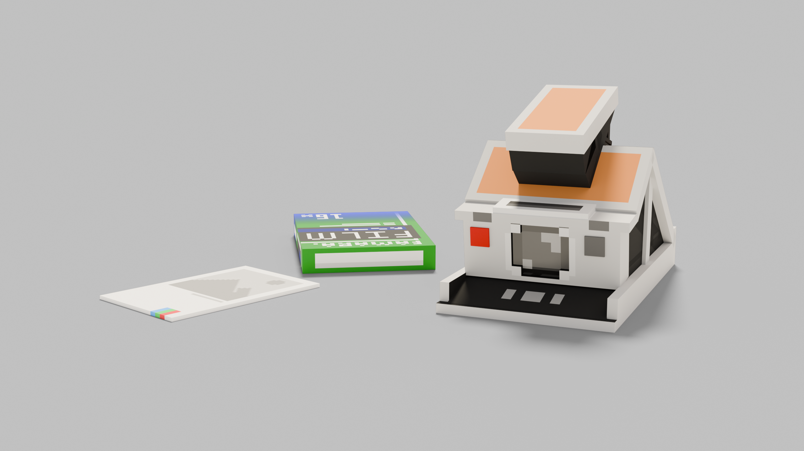
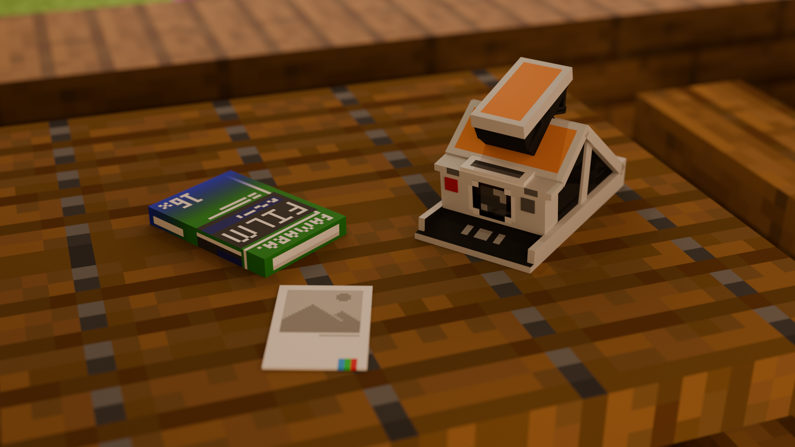
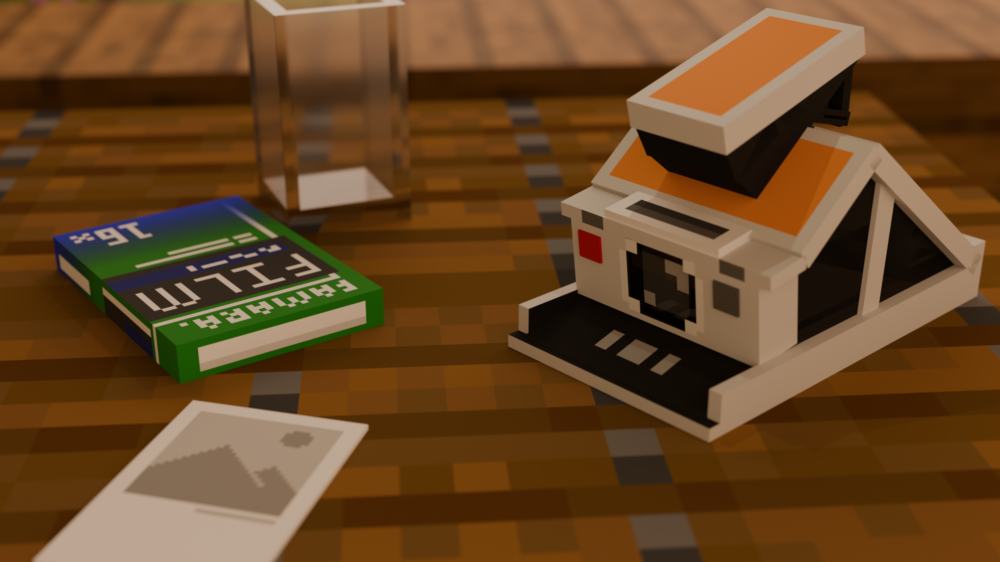

<h2 style="text-align: center;">Famara · 让服务器拥有一台相机</h2>

装填胶卷、打开取景器、按下快门，再亲手把拉片撕开——你眼前的风景，就这样变成一张可以收藏、可以装裱、可以送人的照片。

Famara 是一台属于 Minecraft 服务器的「撕拉片相机」。它保留着胶片时代完整的仪式感：装胶卷、取景、快门、冲洗、撕拉片，每一步都有自己的声音、自己的等待、自己的惊喜。


## 特色玩法

- **真实的拍照流程**：装上胶卷才能按下快门；拍完之后还要拉片、冲洗、撕开，照片才真正诞生。
- **取景器**：手持相机右键开镜，以第一人称取景；取景时的放大强度可以由管理员按服务器的习惯调整。
- **胶卷管理**：把胶卷盒放进背包，手持相机按 `F` 即可装填；每按一次快门消耗一格胶卷，拍完整卷会自动退卷。
- **全套音效**：开镜、快门、拉片、撕开，每个动作都有自己的声音。
- **生物与玩家入镜（26.2 GPU 分支）**：渲染玩家皮肤、原版生物、盔甲与手持物品；完全被不透明方块遮住的模型会被剔除。
- **自定义内容也能入镜**：服务器搭配 CraftEngine 时，自定义方块、家具与物品都会被相机如实记录（可选，不装也能正常使用）。
- **内置配方书**：新玩家初次进服自动领取；左键点开想看的东西，就能看到它的合成配方，创造模式下右键还能直接取用。
- **照片即纪念**：成品照片可以放进展示框挂在墙上、收进箱子珍藏，或和朋友们互相分享。






## 快速上手

1. **领取配方书**：第一次进入服务器会自动获得，也可以随时输入 `/fa guide` 获取。
2. **合成器材**：按配方书攒齐材料，合成「相机」和「胶卷盒」。
3. **装填胶卷**：把胶卷盒放进背包，手持相机按 `F` 完成装填。
4. **打开取景器**：手持相机右键开镜，按 `Shift` 可以随时收镜。
5. **按下快门**：取景状态下再次右键，咔嚓。
6. **拉出拉片**：拍完后 `Shift + 右键`，把拉片从相机里拉出来。
7. **等待显影**：屏幕上会显示「冲洗进度」，冲洗完成后右键撕开拉片，照片就诞生了。

> 小提示：冲洗需要一点时间，进度条上会显示百分比与预计剩余时间，可以一边赶路一边等。

## 命令一览

| 命令                          | 用途                              | 使用对象 |
| --------------------------- | ------------------------------- | ---- |
| `/fa help`                  | 查看帮助列表                          | 所有人  |
| `/fa guide`                 | 获取相机配方书                         | 所有人  |
| `/fa resource`              | 查看材质包的获取方式                      | 所有人  |
| `/fa speed <数值>`            | 调整照片冲洗速度（默认 7；数值越大越快，也会更吃服务器性能） | 管理员  |
| `/fa set <方块名> <R> <G> <B>` | 修正某个方块在照片中的颜色                   | 管理员  |

## 材质包说明

相机、胶卷盒和照片都配有专属模型，需要材质包才能完整显示：

- 服务器安装了 CraftEngine：材质包会随服务器资源包统一分发，玩家无需单独操作；
- 没有安装 CraftEngine：插件会自动生成一份配套材质包，请管理员按 `/fa resource` 的提示提供给玩家。

没有安装材质包也不影响拍照和冲洗，只是这些物品会显示为普通物品的外观。

## 兼容与安装

- **安装**：把插件放入服务器的插件目录并重启即可，没有任何前置要求。
- **服务端**：支持 Paper / Folia 的 1.20 及以上主流版本。
- **可选增强**：安装 CraftEngine 后，照片可以拍下服务器自定义的方块、家具与物品；不安装则一切照常。
- **可调项**：拍照距离、取景器放大强度等，管理员都可以在配置文件中按需调整。

## 26.2 GPU 分支

本 Fork 的验证版本增加玩家与 93 类生物模型、盔甲和手持物品，并使用同一渲染路径处理方块与实体。GPU 配置为 `AUTO` 时先尝试 OpenCL；设备不可用时回退 CPU。保守遮挡只在确认完整模型及装备都被不透明方块遮住时跳过；玻璃、未知区域和部分露出会保留。

26.2 原版方块数据包含客户端提供的全部 1,198 个 `minecraft:blockstates` 定义，CE 资源合并时优先使用服务器生成包和启用的资源，缺少父模型时再从 26.2 原版资源回退。玩家/生物的装备、手持物品会按资源优先级按需读取 CraftEngine 的资源包目录，不会把整套 CE 贴图复制到每张照片的内存中。樱花树叶使用原版粉色贴图，不套用生物群系树叶色调。

完整 26.2 状态与 CE 模型会使资产构建需要比旧默认更大的上限：新配置默认 `assets.maxTotalBytes: 201326592`（192 MiB），共享运行内存仍限制为 512 MiB；已有 schema 11 配置只在该值仍是旧默认 128 MiB 时自动升级，用户自定义值会保留。

源码目标为 Java 25，实拍验证使用 Minecraft 26.2 Paper 和 NVIDIA Quadro P620。构建还需要本机生成的方块资源包，以及生物模型/贴图数据。新的提取工具只读取开发者自行提供的客户端文件。Minecraft 客户端数据不随 Fork 或 JAR 提供：请从自己安装的 26.2 客户端导出，仅在本机放入 `src/main/resources/render-actors/`，并准备 POM 配置的内置方块资源后再构建。

生成实体资源（需要 26.2 客户端 JAR、Paper API JAR，以及包含客户端依赖的 classpath 文件）：

```bash
python3 tools/p620/build_vanilla_actor_data.py \
  --client /path/to/minecraft-26.2-client.jar \
  --classpath-file /path/to/classpath.txt \
  --api /path/to/paper-api.jar \
  --output /tmp/famara-actors-26.2
cp /tmp/famara-actors-26.2/models-26.2.json src/main/resources/render-actors/
cp /tmp/famara-actors-26.2/vanilla-assets-26.2.zip src/main/resources/render-actors/
cp /tmp/famara-actors-26.2/manifest-26.2.json src/main/resources/render-actors/
```

生成的模型 JSON、贴图 ZIP 和插件 JAR 都是本地产物，不提交到 Git。

## 常见问题

- **照片为什么像一幅「方块色块画」？** 相机是用方块与光影的色彩把世界重新绘制成照片的，这是一份独特的手绘感，而不是屏幕截图。
- **照片会拍到玩家和生物吗？** 26.2 GPU 分支支持玩家与原版生物、盔甲和手持物品；完全遮挡的模型不会出现在成品中。
- **按下快门没反应？** 看看相机里是否还有胶卷；把胶卷盒放进背包、按 `F` 装填后就能继续拍摄。
- **撕开时提示「冲洗未完成」？** 稍等片刻，等冲洗进度走完再撕。
- **某个方块在照片里的颜色不对？** 管理员可以用 `/fa set` 为它修正颜色。
- **冲洗太慢或太快？** 管理员可以用 `/fa speed` 调整。


## 感谢有你

> 感谢来自各地的开发者助力项目开发，具体名单请看贡献者列表

## 授权与许可

- 本项目基于上游 Famara（作者 [Wenkrangha](https://github.com/Wenkrangha/Famara)）二次开发，上游代码与素材的版权归原作者所有，其 MIT 授权声明予以保留。
- 本项目重构与新增的部分采用 **CC BY-NC-SA 4.0**（署名—非商业性使用—相同方式共享 4.0 国际）：
  - **允许**：个人游玩，非商业服务器与社群使用，复制、修改、二次开发、再发布；
  - **禁止**：任何形式的商业用途，包括售卖、付费分发或以本插件直接牟利；
  - **二次开发**：基于本项目修改并对外发布的衍生作品，必须以相同协议（CC BY-NC-SA 4.0）开源，并注明原作者与本项目来源。
- 完整许可条款见 `LICENSE` 文件。
